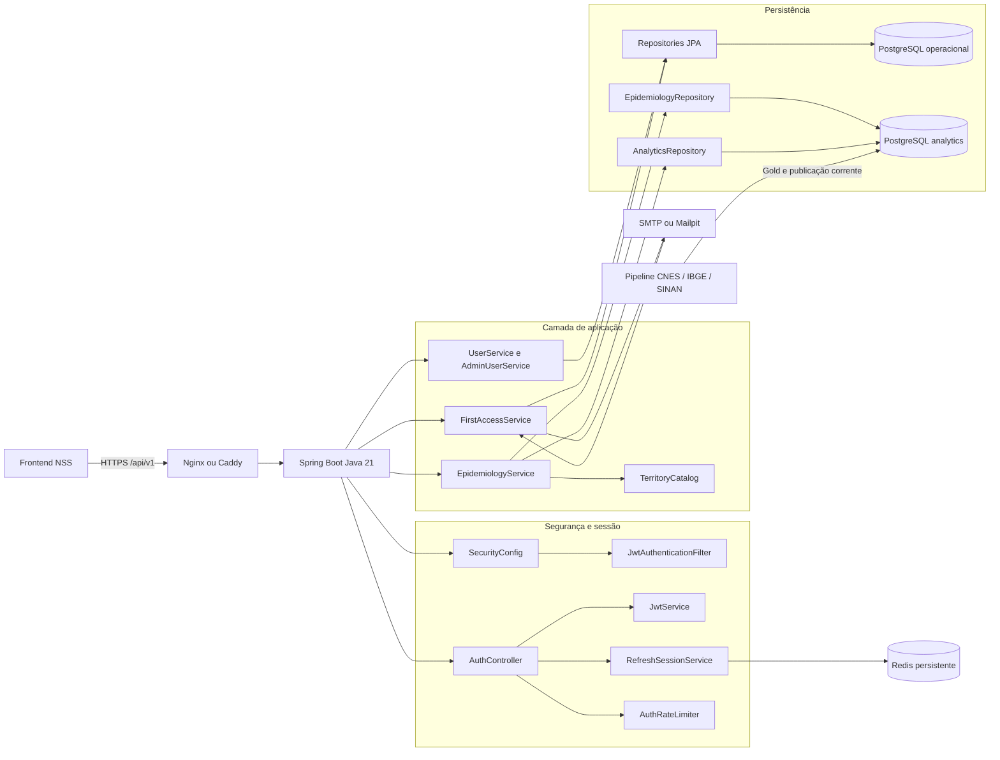

# Sala de Situação de Saúde (NSS) — backend

Backend Spring Boot/Java 21 para autenticação e leitura do PostgreSQL analítico publicado pela pipeline. Não acessa PySUS, SINAN bruto, CNES operacional ou Parquet em runtime.

## Arquitetura

O backend é uma aplicação modular em camadas, organizada por responsabilidade:

- `web`: adaptadores HTTP. Controllers recebem parâmetros, delegam o caso de uso e devolvem DTOs da API.
- `application`: casos de uso e orquestração. Valida filtros, consulta o catálogo territorial, calcula cobertura e compõe respostas.
- `domain`: tipos e regras centrais, como `Geography`, `EpidemiologyFilter`, `CoverageStatus` e `User`.
- `infrastructure`: integração com PostgreSQL, Redis, JPA, JDBC, Flyway, arquivos TSV territoriais e inicialização do administrador.
- `api`: requests e responses públicos. Records são imutáveis e definem o contrato JSON sem expor entidades persistidas.
- `shared`: capacidades transversais, como tratamento de erros e envio de e-mail.

O frontend é o cliente da API. Em produção, o Nginx pode encaminhar `/api/` para o Java, mantendo frontend e API na mesma origem. O Java possui dois datasources independentes:

1. o datasource operacional, usado por JPA/Flyway para usuários, convites e tokens de primeiro acesso;
2. o datasource analítico, somente leitura, usado por `JdbcTemplate` para consultar `analytics.*`, publicado pela pipeline;
3. o Redis persistente, usado para refresh sessions e rate limit distribuído de autenticação.

O Java nunca lê Parquet, PySUS, SINAN bruto ou CNES em tempo de consulta. A pipeline processa esses artefatos, enriquece os fatos com CNES/IBGE e publica o resultado no PostgreSQL. A tabela `analytics.pipeline_current_publication` restringe as consultas ao lote corrente de cada doença, ano e município.

### Visão geral do fluxo



### Fluxos principais

#### Consulta epidemiológica

`EpidemiologyController` expõe regiões, estados, municípios, distritos, bairros, doenças e metadata. Ele converte os parâmetros HTTP em `FilterRequest` e `EpidemiologyFilter`, e delega ao `EpidemiologyService`.

O serviço então:

1. valida doença, ano, mês, sexo, faixa etária e códigos geográficos;
2. resolve os territórios permitidos no `TerritoryCatalog`;
3. chama `EpidemiologyRepository` para agregar `analytics.fato_casos`;
4. aplica a publicação corrente, os filtros de área e o status de cobertura;
5. monta `AnalyticsResponse`, contendo filtros efetivos, total, cobertura, itens territoriais e metadata da publicação.

O frontend recebe os totais já calculados. Ele não acessa o banco e não soma casos para formar o total epidemiológico.

#### Autenticação

`AuthController` coordena login, refresh, logout, primeiro acesso, recuperação de senha e endpoint CSRF. O login valida credenciais com `UserService`, aplica `AuthRateLimiter`, emite JWT pelo `JwtService` e grava o refresh token somente como cookie HttpOnly por meio de `RefreshSessionService`. As sessões de refresh ficam em hashes Redis com TTL e rotação protegida por lock; não são mais persistidas em SQL.

`JwtAuthenticationFilter` lê o bearer token, valida sua assinatura e carrega o usuário pelo `CustomUserDetailsService`. `SecurityConfig` define rotas públicas, CORS, CSRF, cookies, permissões e a política stateless.

#### Administração de usuários

`AdminUserController` é protegido pela permissão `USER_MANAGEMENT` e delega convite, pesquisa, ativação, cancelamento, renovação e reset de senha ao `AdminUserService`. `FirstAccessService` controla tokens de primeiro acesso e usa `MailService` para enviar convites e links.

### Classes por camada

| Área | Classes | Responsabilidade |
| --- | --- | --- |
| Entrada | `NssApplication` | Inicializa o Spring Boot. |
| Analytics web | `EpidemiologyController`, `AnalyticsController` | Expõe a API epidemiológica e a consulta legada de casos. |
| Usuários web | `AuthController`, `AdminUserController` | Expõe autenticação, primeiro acesso, recuperação e administração. |
| Analytics application | `EpidemiologyService`, `AnalyticsService`, `TerritoryCatalog` | Orquestra consultas, cobertura, metadata e catálogo territorial. |
| Usuários application | `UserService`, `AdminUserService`, `FirstAccessService`, `RefreshSessionService` | Executa os casos de uso de identidade e sessão. |
| Segurança | `SecurityConfig`, `JwtService`, `JwtAuthenticationFilter`, `CustomUserDetailsService`, `EmailNormalizer`, `AuthRateLimiter` | Protege endpoints, normaliza identidade, limita tentativas e valida JWT. |
| Analytics persistence | `EpidemiologyRepository`, `AnalyticsRepository`, `EpidemiologyRowMapper` | Executa SQL analítico e transforma linhas em records internos. |
| Usuários persistence | `UserRepository`, `FirstAccessTokenRepository` | Acessa usuários e tokens de primeiro acesso via Spring Data JPA. |
| Configuração | `AnalyticsDataSourceConfig`, `BootstrapAdminInitializer` | Cria os dois datasources e inicializa o administrador configurado. |
| Contratos | `AnalyticsResponse`, `MetadataResponse`, `LoginResponse`, `UserResponse` e demais records | Define o JSON público da API. |
| Transversal | `GlobalExceptionHandler`, `ErrorResponse`, `MailService` | Padroniza erros e entrega notificações por e-mail. |

### Métodos privados e encapsulamento

Os métodos `private` não são endpoints nem casos de uso públicos. São partes internas das classes acima e existem para manter regras auxiliares no lugar correto:

- `EpidemiologyService.response(...)` centraliza a montagem de `AnalyticsResponse`; `areaEntries(...)` resolve a lista territorial e `regionOf(...)` traduz UF para região.
- `EpidemiologyRepository.mappedPredicate(...)`, `currentPublicationPredicate()`, `parameters(...)`, `appendAreaFilter(...)` e `regionUfs(...)` constroem as partes controladas do SQL. `identifier(...)` valida nomes de coluna configuráveis antes de inseri-los na query.
- `TerritoryCatalog.load()`, `loadMunicipalities()` e `readTsv(...)` carregam e validam os catálogos TSV uma única vez; o `record Entry` representa uma entrada territorial imutável.
- `EpidemiologyRowMapper` tem construtor privado porque é uma fábrica estática de `RowMapper`; não representa um objeto com estado.
- `UserService.view(...)` e `AdminUserService.view(...)` convertem entidades em respostas sem expor senha, hash ou detalhes de persistência.
- `AuthRateLimiter.check(...)`, `reserve(...)` e `key(...)` executam scripts atômicos no Redis; a janela expira por TTL e o estado não fica preso à memória de uma instância.
- `RefreshSessionService.newSession(...)`, `saveRedis(...)`, `readRedis(...)` e `rotateLegacy(...)` encapsulam o formato Redis, o TTL e a rotação.
- `EmailNormalizer` tem construtor privado porque é uma classe utilitária estática; `SecureRandomTokenGenerator` encapsula a geração criptograficamente segura de tokens.
- Campos `private final` de controllers, serviços e repositories são dependências injetadas pelo Spring. Campos privados de `User` e `FirstAccessToken` são o estado persistido em SQL; os campos de `RefreshSession` representam o payload interno serializado no Redis.

Manter esses elementos privados impede que controllers, frontend ou outros módulos dependam de detalhes de implementação. Se uma regra precisar ser reutilizada por mais de uma classe, ela deve ser extraída para um serviço, mapper ou componente com contrato próprio, em vez de simplesmente tornar o método público.

### Banco e migrações

O Flyway migra o schema operacional `public`. O Alembic da pipeline migra o schema analítico `analytics`; os dois históricos são independentes. O arquivo `V0001__initial_schema.sql` é a migration inicial consolidada (`version=1`, exibida operacionalmente como `0001`) e representa diretamente o estado atual do schema SQL: `users`, `user_first_access` e índices de e-mail normalizado. Refresh sessions e rate limits são dados Redis, com TTL e persistência AOF.

Essa consolidação é o ponto de partida para bancos novos. Ela substitui o histórico anterior `V1`–`V6`; não deve ser aplicada sobre um banco que ainda tenha `flyway_schema_history` apontando para as migrations antigas sem antes recriar o schema operacional ou executar um procedimento explícito de baseline controlado. O banco analítico e seus dados não são apagados por essa mudança.

Em um ambiente descartável, recrie somente o schema operacional antes de iniciar o Java para que o Flyway execute a `0001` desde o início. Em um banco compartilhado já existente, use `SPRING_FLYWAY_BASELINE_ON_MIGRATE=true` e `SPRING_FLYWAY_BASELINE_VERSION=0` apenas quando as tabelas atuais já forem equivalentes ao schema consolidado; isso registra o ponto de partida sem modificar as tabelas analíticas.

O datasource analítico usa `read-only=true`. A aplicação consulta `dim_doenca`, `dim_municipio`, `dim_unidade_saude`, `fato_casos` e `pipeline_current_publication`; a pipeline é a responsável por escrever e publicar esses dados.

## Execução local

Configure `SPRING_DATASOURCE_URL`, `SPRING_DATASOURCE_USERNAME`, `SPRING_DATASOURCE_PASSWORD`, `ANALYTICS_DATASOURCE_URL`, `ANALYTICS_DATASOURCE_USERNAME`, `ANALYTICS_DATASOURCE_PASSWORD` e `JWT_SECRET` sem versionar segredos. Exemplo:

```bash
export ANALYTICS_DATASOURCE_URL=jdbc:postgresql://localhost:5432/situacao_saude
export ANALYTICS_DATASOURCE_USERNAME=nss
export ANALYTICS_DATASOURCE_PASSWORD='...'
export JWT_SECRET='base64-com-pelo-menos-32-bytes'
./mvnw -Pdev spring-boot:run
```

O perfil Maven `dev` adiciona somente a integração do Spring Boot com o
`compose.yaml`. Ele é destinado à execução local e não é ativado no Docker.

## Dependências por ambiente

- **Produção/Docker:** o `Dockerfile` compila a aplicação com Java 21 e gera
  uma imagem final somente com o JRE e o JAR empacotado. As dependências de
  runtime da aplicação (Spring Web, JPA, PostgreSQL, segurança, JWT, Flyway,
  Actuator e métricas) são empacotadas nesse JAR.
- **Desenvolvimento local:** `./mvnw -Pdev spring-boot:run` habilita o starter
  `spring-boot-docker-compose`, que permite ao Spring iniciar o
  `compose.yaml` automaticamente.
- **Testes e build/CI:** `./mvnw test` ou `./mvnw verify` usam dependências com
  escopo `test` somente durante a compilação e execução dos testes. O perfil
  `dev` não é ativado no CI nem no build da imagem.
- **Compilação:** MapStruct e Lombok têm escopo `provided` e seus processadores
  geram o código durante o build; eles não são necessários em runtime.

Para executar tudo via Docker, use:

```bash
docker compose up --build
```

Nesse fluxo o Compose é executado externamente pelo Docker, portanto o
starter `spring-boot-docker-compose` não precisa estar na imagem final.

O compose usa o PostgreSQL configurado pela pipeline por padrão e não cria um `analytics-db` incompatível. O usuário analítico deve ser somente leitura. `CORS_ALLOWED_ORIGINS` e `SECURE_COOKIES` são explícitos para produção.

## API V1

Autenticação: `POST /api/v1/auth/login`, `/refresh` e `/logout`. O access token é retornado no corpo; refresh fica em cookie HttpOnly. Endpoints: `/api/v1/diseases`, `/api/v1/metadata`, `/api/v1/epidemiology/municipalities`, `/districts` e `/neighborhoods`.

Filtros: `disease`, `year`, `month`, `sex` (`M`/`F`), `ageBand`, `municipalityCode` e `districtCode`. Sexo omitido consulta `M`, `F` e `I`; ano/mês omitidos significam todos. O envelope sempre contém `totalNotifications`, `coverage` e `items`; o frontend não soma os itens.

O bairro é o bairro da notificação derivado da unidade notificadora via CNES, não o endereço residencial do paciente. Ausência de mapeamento é reportada em `coverage`, não como bairro fictício. Ver o relatório em [documentation/BACKEND_API_V1_AUDIT_AND_IMPLEMENTATION.md](documentation/BACKEND_API_V1_AUDIT_AND_IMPLEMENTATION.md).

## Testes

`./mvnw test` usa H2 em profile de teste e não depende de variáveis secretas. A validação PostgreSQL deve usar o schema real da pipeline e dataset mínimo controlado, sem apagar volumes nem publicar dados SINAN.

## Qualidade do código

`./mvnw verify` valida a formatação com Spotless, as regras de estilo com
Checkstyle e code smells com PMD. Para formatar os arquivos localmente antes do
commit, execute:

```bash
./mvnw spotless:apply
```

O JaCoCo coleta cobertura durante `test` e `verify` e publica relatórios HTML,
XML e CSV em `target/site/jacoco/`, com visões separadas em `unit/` e
`integration/`. O planejamento incremental está em
[documentation/PLANEJAMENTO_TESTES.md](documentation/PLANEJAMENTO_TESTES.md).

O checklist de deploy, smoke test, backup/restauração, rollback e observabilidade
está em [documentation/OPERACAO_PRODUCAO.md](documentation/OPERACAO_PRODUCAO.md).
